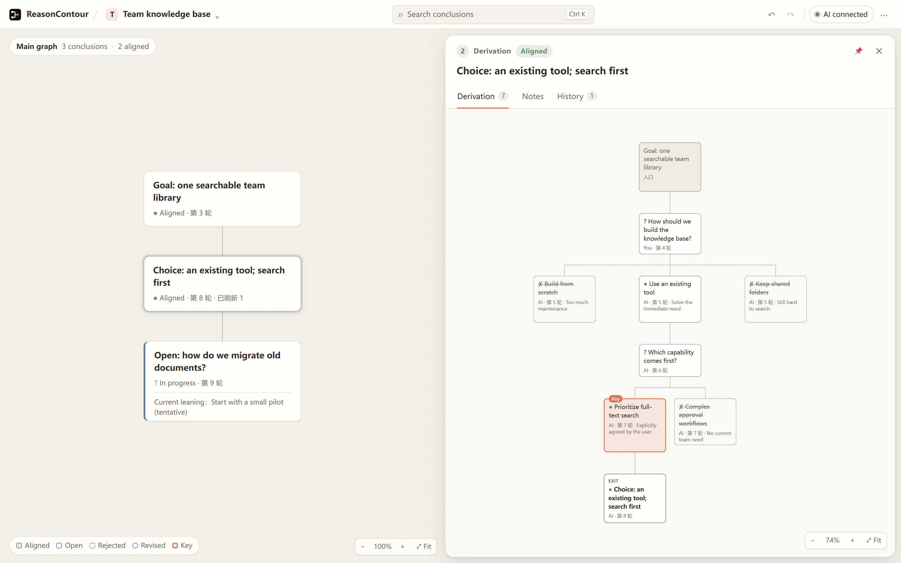

<p align="center">
  
</p>
<h1 align="center">ReasonContour</h1>
<p align="center">
  <a href="README.md">简体中文</a> · <strong>English</strong>
</p>
<p align="center">
  <a href="LICENSE"></a>
  <a href="#quick-start"></a>
  <a href="docs/AI_USAGE.md"></a>
</p>

**See how you and AI reach a conclusion, step by step.**

Complex discussions with AI can easily drift. Conclusions pile up; earlier decisions get revised or rejected. By turn 30, no one remembers why a decision was made—or whether the conversation has gone off track. ReasonContour turns the discussion into an evolving reasoning map, keeping its main thread clear and making every change to a conclusion easy to review or audit.



<p align="center"><sub>Actual app screenshot · Invented example: choosing a team knowledge base</sub></p>

**Conclusions on the main graph: each node marks a real point of convergence. Read through it to see the structure of the entire discussion.**<br />
**Reasoning in the side graph: open a conclusion to see how it was reached, including rejected options and the reasons behind them.**<br />
**A live frontier: the last node holds the question being discussed. Once you agree, it becomes a settled conclusion.**<br />
**Agreement is yours to confirm: only what you explicitly accept is settled. AI cannot silently rewrite it.**<br />
**Automatic and manual: AI organizes the map; when you disagree, promote, merge, delete, or edit. Every step can be undone.**

## Quick start

Requires **Node.js 22.12 or later**.

```sh
git clone https://github.com/neo39351/ReasonContour.git
cd ReasonContour
npm ci
npm run build
npm start
```

Open the local URL printed in your terminal. Run the app in a local browser on Windows, macOS, or Linux.

## Connect the AI you already use

From the canvas **AI** menu, copy the connection instructions or MCP configuration into an MCP-capable AI client or a coding assistant that can execute local commands. Start a separate session for each discussion you want to record. Your AI can then maintain the main and side graphs as you talk. A CLI is also available.

ReasonContour does not run a model or automatically read other chats. Automatic organization requires a connected AI to write updates, and only discussions you choose to connect are recorded. See the [agent integration guide](docs/AI_USAGE.md).

## Work with the canvas

| Action | How |
| --- | --- |
| Promote | Use a side node's menu to turn a derivation into a main conclusion |
| Merge | Drag a main node onto an adjacent node; preview, then release to save |
| Delete | Use the node menu; its derivation is retained and transferred |
| Edit | Double-click a title |
| Undo / redo | `Ctrl+Z` / `Ctrl+Shift+Z` |

The side panel follows the current frontier. Select another conclusion to pin its reasoning, body, and history. The More menu includes Chinese / English, Light / Dark / System appearance, and Markdown export.

## Local data

Discussions are stored as plaintext files in `projects/` on your machine. Set `REASONCONTOUR_DATA_DIR` to use another location. There are no built-in accounts, telemetry, or automatic cloud backups. When you connect an external AI, its data handling follows your chosen client and service configuration.

The current storage format is **v4**. Older formats are not migrated automatically; keep a backup or use a separate data directory.

## Development and contributions

```sh
npm test
npm run build
npx playwright install chromium
npm run test:browser
```

See [Contributing](CONTRIBUTING.md), [Development](docs/DEVELOPMENT.md), [Architecture](docs/ARCHITECTURE.md), and the [reasoning graph mechanism](docs/design/TREE_MECHANISM_SPEC.md). To build the optional Windows desktop host from source, run `desktop/build.ps1`; it requires the .NET Framework compiler, Node.js, and WebView2 Runtime.

## License

[MIT](LICENSE). See [THIRD_PARTY_NOTICES.md](THIRD_PARTY_NOTICES.md) for dependency licenses.
