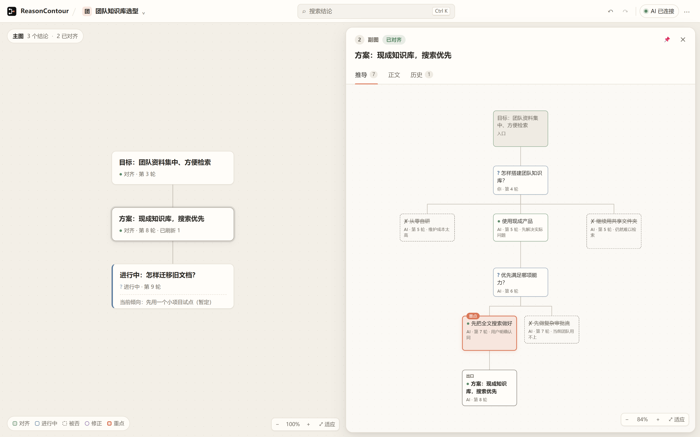

<p align="center">
  
</p>
<h1 align="center">ReasonContour</h1>
<p align="center">
  <strong>简体中文</strong> · <a href="README.en.md">English</a>
</p>
<p align="center">
  <a href="LICENSE"></a>
  <a href="#快速开始"></a>
  <a href="docs/AI_USAGE.md"></a>
</p>

**看清你和 AI 的讨论，是怎样一步步得出结论的。**

和 AI 的复杂讨论很容易跑偏：结论越积越多，早先的结论更新或被否，聊到第 30 轮时，已经没人记得当初为什么那样决定，甚至跑偏。ReasonContour 会把讨论变成一张随讨论更新的推理地图，让讨论主线时刻维持清晰，同时让每一次结论更新都能被方便地查看或审计。



<p align="center"><sub>实际界面截图 · 自拟示例：团队知识库选型</sub></p>

**主图只放结论：每个节点都是一次真正的收敛，读一遍就能看清整场讨论的骨架。**<br />
**副图保留推导：点开一条结论，就能看到它是怎么得出的，被否的选项和理由都在。**<br />
**前沿实时刷新：最后一个节点是正在讨论的问题，达成一致后定格成结论。**<br />
**对齐由你确认：只有你明确认同的内容才算定下，AI 不能擅自改写。**<br />
**自动与手动：AI 自动整理；你不认同时，可以用升、并、删、改四个操作调整，每一步都能撤销。**

## 快速开始

需要 **Node.js 22.12 或更高版本**。

```sh
git clone https://github.com/neo39351/ReasonContour.git
cd ReasonContour
npm ci
npm run build
npm start
```

打开终端输出的本地地址，即可使用画布。Windows、macOS 和 Linux 均可通过本地浏览器运行。

## 接入你正在使用的 AI

在画布的 **AI** 菜单中复制连接说明或 MCP 配置，交给支持 MCP 的 AI 客户端或具备本地命令执行能力的编程助手。每段需要记录的讨论启动一个独立会话，之后 AI 就能随讨论维护主图与副图；不使用 MCP 时，也可通过 CLI 接入。

ReasonContour 本身不运行模型，也不会自动读取其他聊天。自动整理需要已连接的 AI 主动写入；只有你选择接入的讨论才会被记录。详见 [AI 接入指南](docs/AI_USAGE.md)。

## 在画布上操作

| 操作 | 使用方式 |
| --- | --- |
| 升 | 在副图节点菜单中，将一条推导升为主图结论 |
| 并 | 将主图节点拖到相邻节点，预览合并后松开保存 |
| 删 | 在节点菜单中删除，推导会保留并转接 |
| 改 | 双击标题直接编辑 |
| 撤销 / 重做 | `Ctrl+Z` / `Ctrl+Shift+Z` |

侧栏默认跟随当前前沿；选择其他结论即可固定查看它的推导、正文与历史。更多菜单中可切换中英文和浅色 / 深色 / 跟随系统，并导出 Markdown。

## 本地数据

讨论以明文文件保存在本机 `projects/` 目录。可通过环境变量 `REASONCONTOUR_DATA_DIR` 指定其他位置。没有内置账号、遥测或自动云备份；接入外部 AI 后，其数据处理遵循你选择的 AI 客户端和服务配置。

当前存储格式为 **v4**，旧格式不会自动迁移；请为旧数据保留备份或使用独立数据目录。

## 开发与贡献

```sh
npm test
npm run build
npx playwright install chromium
npm run test:browser
```

参阅 [贡献指南](CONTRIBUTING.md)、[开发说明](docs/DEVELOPMENT.md)、[架构](docs/ARCHITECTURE.md) 和 [推理图机制](docs/design/TREE_MECHANISM_SPEC.md)。可选的 Windows 桌面外壳从源码运行 `desktop/build.ps1` 构建，需要 .NET Framework 编译器、Node.js 与 WebView2 Runtime。

## 许可证

[MIT](LICENSE)。第三方依赖的许可说明见 [THIRD_PARTY_NOTICES.md](THIRD_PARTY_NOTICES.md)。
